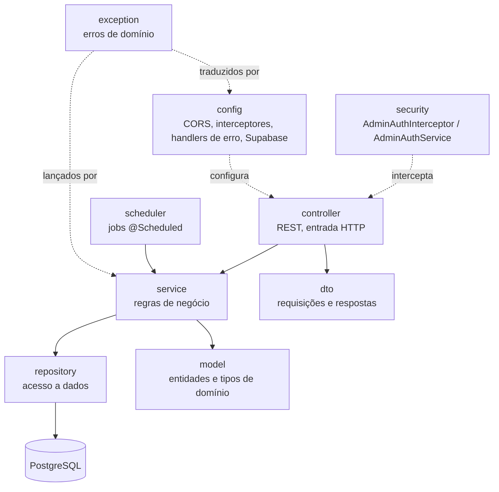
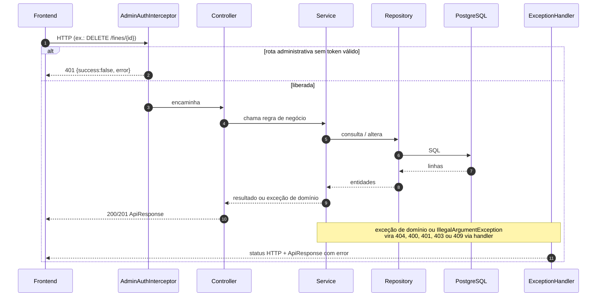
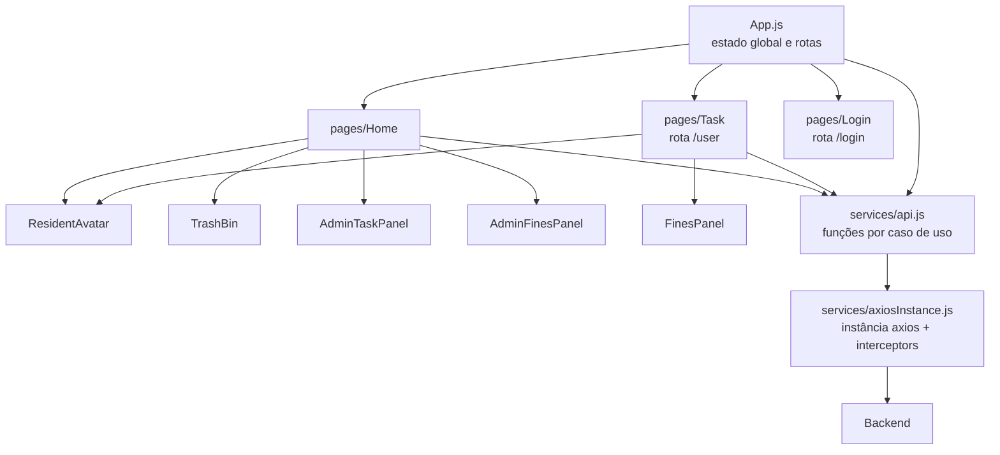
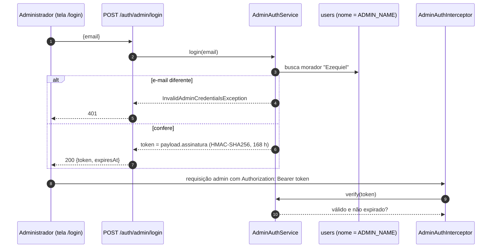
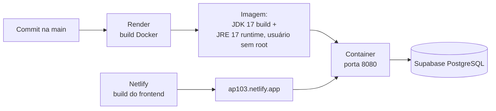

# Arquitetura do sistema AP103

Sistema de gestão da casa (apartamento 103): distribuição semanal de tarefas, controle do lixo, multas entre moradores e uma área administrativa.

Este documento descreve a arquitetura completa. Os detalhes de entrada e saída estão em [api.md](api.md), e o contrato OpenAPI em [openapi.yaml](openapi.yaml). O modelo de dados está em [diagramas-banco.md](diagramas-banco.md) e no [schema.sql](schema.sql).

---

## 1. Visão geral

```mermaid
flowchart LR
    subgraph Navegador
        FE[Frontend React<br/>Netlify]
    end
    subgraph Render
        BE[Backend Spring Boot 3 / Kotlin<br/>Docker]
        SCH[(Schedulers<br/>@Scheduled)]
    end
    subgraph Supabase
        PG[(PostgreSQL 16)]
    end
    GH[GitHub Actions<br/>keep-alive diário]

    FE -- "HTTPS JSON<br/>(Bearer no admin)" --> BE
    BE -- "JDBC / JPA" --> PG
    SCH -. "roda dentro do backend" .-> BE
    GH -- "GET /residents às 09:00" --> BE
```

| Componente | Tecnologia | Onde roda | Responsabilidade |
|---|---|---|---|
| Frontend | React 18, React Router 6, axios | Netlify (`ap103.netlify.app`) | Telas dos moradores e do administrador |
| Backend | Kotlin 1.9, Spring Boot 3.2, Java 17 | Render (Docker, plano gratuito) | Regras de negócio, API REST e tarefas agendadas |
| Banco | PostgreSQL 16 | Supabase (produção); `docker-compose.yml` (local) | Persistência |
| Keep-alive | GitHub Actions (cron) | GitHub | Acorda o backend do Render antes do horário de uso |

Há um detalhe operacional importante: no plano gratuito do Render o serviço hiberna sem requisições. Como as tarefas agendadas rodam dentro do processo do backend, elas só executam se o serviço estiver acordado. Por isso a rotação semanal também é disparada pelo primeiro acesso a `GET /tasks/weekly` (ver seção 6).

---

## 2. Estrutura do backend

Pacotes em `src/main/kotlin/com/aptasks/`:



| Pacote | Conteúdo | Observações |
|---|---|---|
| `controller` | `TaskController`, `FineController`, `ResidentController`, `TrashController`, `AdminAuthController` | Só recebe, valida o formato e delega. Retorna sempre `ApiResponse`. |
| `service` | `TaskService`, `TaskRotationService`, `FineService`, `TrashService`, `AuthService` | Regras de negócio e transações (`@Transactional`). |
| `repository` | `TaskRepository`, `TaskRotationRepository`, `TaskRotationHistoryRepository`, `FineRepository`, `TrashRepository`, `UserRepository` | Consultas com `JdbcTemplate` (SQL explícito). |
| `model` | `Task`, `User` (entidades JPA), `Fine`, `TrashStatus` | Tipos do domínio. |
| `dto` | Requisições e respostas por área (`task`, `fine`, `trash`, `login`, `dashboard`) e `ApiResponse` | Desacopla o contrato HTTP das entidades. |
| `security` | `AdminAuthService`, `AdminAuthInterceptor` | Autenticação do administrador (ver seção 5). |
| `scheduler` | `OverdueTaskScheduler`, `WeeklyTaskRotationScheduler` | Jobs periódicos. |
| `config` | `CorsConfig`, `AdminWebConfig`, `GlobalExceptionHandler`, `TrashExceptionHandler`, `SupabaseConfig` | Infraestrutura web. |
| `exception` | `TaskNotFoundException`, `FineNotFoundException`, `TrashConflictException`, `TrashForbiddenException` | Erros de domínio com mensagem em português. |

`WeeklyTaskScheduler.kt` contém apenas código comentado de uma versão anterior. Ele não é ativo e pode ser removido.

### Fluxo de uma requisição



---

## 3. Modelo de dados

Resumo (detalhes e chaves em [diagramas-banco.md](diagramas-banco.md)):

| Tabela | Papel | Chave |
|---|---|---|
| `users` | Moradores (`name`, `email`, `is_at_home`, `homework_is_done`) | `id` (UUID) |
| `tasks` | Tarefas de limpeza, com responsável atual, prazo, decisão e multa | `id` (UUID) |
| `fines` | Multas entre moradores (`amount` em `NUMERIC(10,2)`) | `id` (UUID) |
| `trash_status` | Estado único do lixo: responsável, nível (`EMPTY`, `HALF`, `FULL`) e quem informou | linha única |
| `task_rotation_runs` | Uma linha por semana já rotacionada | `week_start` (DATE, PK) |
| `task_rotation_history` | Atribuições por tarefa e semana | `(task_id, week_start)` único |

As migrações V2, V3 e V4 não são aplicadas automaticamente. Elas precisam ser executadas manualmente no SQL Editor do Supabase, como indicado no README.

---

## 4. Frontend



| Parte | Função |
|---|---|
| `App.js` | Concentra o estado (moradores, tarefas, lixo, multas, token do administrador) e distribui por props. As rotas são `/`, `/home`, `/login` e `/user`. |
| `pages/Home` | Perfis, quadro semanal, painel do lixo e, para o administrador, os painéis de tarefas e multas. |
| `pages/Task` | Tela do morador: tarefas da semana, presença em casa e multas. |
| `pages/Login` | Login do administrador pelo e-mail. |
| `components/TrashBin` | Desenho SVG da lixeira, que muda conforme o nível. |
| `components/ResidentAvatar` | Avatar animado em SVG, com aparência fixa por morador. |
| `services/api.js` | Uma função por operação da API. As telas não conhecem URLs. |
| `services/axiosInstance.js` | Instância do axios com a URL base, inclusão do `Bearer` e tratamento de 401. |

A URL do backend vem de `REACT_APP_API_URL` no build e, na falta dela, usa o backend do Render.

---

## 5. Autenticação e autorização

O sistema não tem login de morador. Qualquer pessoa escolhe o próprio perfil na tela inicial. Apenas o administrador se autentica.



Rotas protegidas (`AdminAuthInterceptor.PROTECTED_ROUTES`):

- `POST /tasks/create`
- `PUT /tasks/*`
- `DELETE /tasks/*`
- `GET /fines/admin`
- `DELETE /fines/*`

Chave de assinatura: `ADMIN_TOKEN_SECRET`, quando definida. Sem ela, o backend usa uma chave fixa no código e a proteção depende apenas do e-mail. Esse é um risco aceito e está registrado no commit `8bc3999`. Para voltar à proteção por segredo, basta definir a variável com 32 caracteres ou mais.

No frontend, o token fica em `localStorage` (chave `token`) e é enviado em cada requisição. Quando o backend responde 401, o token é removido e o evento `ap103:admin-session-expired` faz a interface sair do modo administrador.

---

## 6. Regras de negócio principais

| Regra | Onde | Detalhe |
|---|---|---|
| Rotação semanal | `TaskRotationService.rotateCurrentWeek` | A tarefa `i` vai para o morador `(i + semana) mod N`, ordenado por nome e id. Cada semana gera uma nova distribuição. |
| Idempotência da rotação | `TaskRotationRepository.registerWeekIfAbsent` | `INSERT ... ON CONFLICT DO NOTHING` em `task_rotation_runs`. Só uma execução por semana, mesmo com várias instâncias. |
| Proteção contra repetição | `TaskRotationService` | Se a tarefa cair de novo no responsável da semana anterior, avança um morador e registra um `warn` no log. |
| Disparo sob demanda | `TaskController.readWeeklyTasks` | `GET /tasks/weekly` chama a rotação antes de responder. Por isso ela ocorre mesmo com o serviço dormindo às 00:10. |
| Nova tarefa no meio da semana | `TaskRotationService.assignNewTaskForCurrentWeek` | Vai para o morador com menos tarefas. |
| Prazo e multa automática | `OverdueTaskScheduler`, `TaskService.evaluateOverdueTasks` | A cada hora, tarefas vencidas e não feitas geram uma multa de `tasks.fine.amount` (padrão 5,00) do remetente configurado. Cada tarefa é multada uma única vez (`fine_applied_at`). |
| Decisão da tarefa | `TaskService.setCompletion` | Feita ou não feita. Decisão tardia é avaliada imediatamente. |
| Lixo: responsável | `TrashService.assignResponsible` | Qualquer morador pode ser definido como responsável. |
| Lixo: avisos | `TrashService.reportHalf/reportFull` | "Meio cheia" só é gravado se o lixo estiver vazio; "cheia" só se ainda não estiver cheio. Avisos repetidos respondem o estado atual sem gravar nada. |
| Lixo: esvaziar | `TrashService.markEmptied` | Somente o responsável atual pode marcar como esvaziado (403). Se já está vazio, retorna 409. |
| Multas | `FineService` | Remetente e destinatário precisam ser moradores diferentes. Valor maior que zero e no máximo o limite configurado. |

---

## 7. Tarefas agendadas

| Job | Cron padrão | Fuso | Função |
|---|---|---|---|
| `OverdueTaskScheduler` | `0 0 * * * *` (`TASK_OVERDUE_CRON`) | padrão do servidor (`TZ=America/Sao_Paulo` no contêiner) | Avalia tarefas vencidas e aplica multas. |
| `WeeklyTaskRotationScheduler` | `0 10 0 * * *` (`TASK_ROTATION_CRON`) | `America/Sao_Paulo` | Roda a rotação semanal todo dia às 00:10. Só altera tarefas uma vez por semana. |

Os dois jobs dependem de `@EnableScheduling` em `AptasksApplication`. Como o plano gratuito hiberna o serviço, o job de 00:10 pode não rodar. A rotação então acontece no primeiro `GET /tasks/weekly` do dia ou da semana.

---

## 8. Infraestrutura e implantação



- O `Dockerfile` tem dois estágios: compilação do JAR com JDK 17 e execução com JRE 17 enxuto, rodando como usuário sem privilégios.
- Variáveis de ambiente do backend: `DB_URL`, `DB_USERNAME`, `DB_PASSWORD`, `PORT`, `ADMIN_NAME`, `ADMIN_TOKEN_SECRET`, `ADMIN_TOKEN_TTL_HOURS`, `TASK_OVERDUE_CRON`, `TASK_ROTATION_CRON`, `TZ`.
- CORS permite `http://localhost:3000`, `http://localhost:3001` e `https://ap103.netlify.app`.
- Banco local: `docker compose up -d` sobe PostgreSQL 16 na porta 5433, já com `schema.sql` e `seed.sql`.

---

## 9. Padrões de projeto e decisões

| Padrão | Onde aparece | Por quê |
|---|---|---|
| Camadas (controller, service, repository) | Backend inteiro | Separar HTTP, regra de negócio e persistência. |
| Injeção de dependência por construtor | Todas as classes Spring | Facilita testes com mocks (MockK). |
| Repository com SQL explícito | `*Repository.kt` com `JdbcTemplate` | Controle sobre `ON CONFLICT`, `FOR UPDATE SKIP LOCKED` e as tabelas de rotação. |
| DTO e mapeamento manual | `dto/` e `toResponse()` | O contrato HTTP não expõe as entidades. |
| Interceptor | `AdminAuthInterceptor` | Protege rotas por método e caminho, sem repetir código nos controllers. |
| Handler global de exceções | `GlobalExceptionHandler`, `TrashExceptionHandler` | Converte erros de domínio em respostas HTTP padronizadas. |
| Operação idempotente | `registerWeekIfAbsent`, `ON CONFLICT` em `task_rotation_history` | Permite rodar a rotação de novo sem duplicar nada. |
| Estado derivado por nível | `TrashBin` e `FILL_PERCENT` (frontend) | Um único mapa define altura, cor e animação. |
| Fachada de API | `services/api.js` | As telas chamam funções nomeadas, e a URL fica em um lugar só. |
| Evento de janela para sessão expirada | `ADMIN_SESSION_EXPIRED_EVENT` | O interceptor do axios avisa a interface sem acoplamento direto. |
| Estado elevado ao `App.js` | `App.js` | Poucas telas e um único estado compartilhado. Não há Redux. |

### Dívidas técnicas conhecidas

- `frontend/src/services/api.js` tem funções `registerUser`, `loginUser`, `logoutUser` e `setStatusTasks` que chamam `/register`, `/login`, `/logout` e `tasks`, rotas que não existem no backend. Nenhuma tela as usa.
- `AuthController.kt` está inteiro comentado, e `AuthService.kt` não é usado pelos controllers.
- `WeeklyTaskScheduler.kt` contém só código comentado.
- `TestController` expõe `GET /api/v1/hello` para teste.
- O `springdoc` não está no build, então o Swagger não é servido pelo próprio backend. O arquivo [openapi.yaml](openapi.yaml) pode ser aberto no Swagger Editor ou no Swagger UI.
- Sem `ADMIN_TOKEN_SECRET`, a autenticação do administrador depende só do e-mail (risco aceito, ver seção 5).
