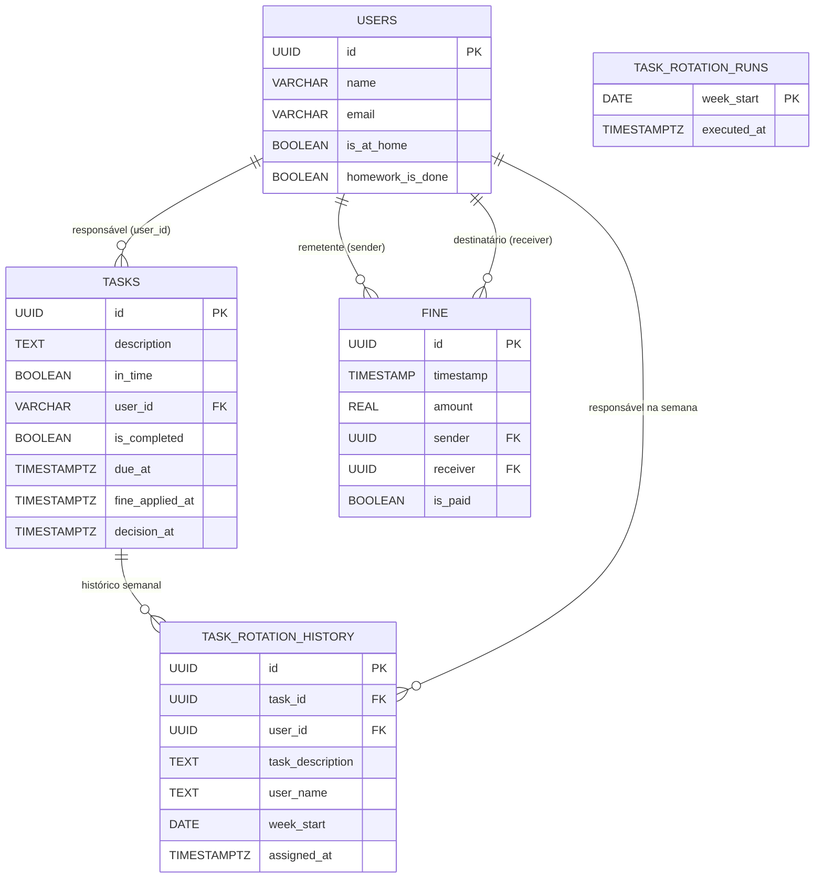

# Diagramas do banco de dados

Os diagramas abaixo foram reconstruídos a partir dos modelos Kotlin, das consultas SQL dos repositórios e das migrações disponíveis no backend. O projeto não contém uma migração inicial para `users`, `tasks` e `fine`; portanto, tipos e relacionamentos dessas tabelas são inferidos e devem ser conferidos no PostgreSQL real.

## Diagrama ER



## Diagrama relacional

```text
USERS (
  id UUID PK,
  name VARCHAR,
  email VARCHAR,
  is_at_home BOOLEAN,
  homework_is_done BOOLEAN
)

TASKS (
  id UUID PK,
  description TEXT,
  in_time BOOLEAN,
  user_id VARCHAR,
  is_completed BOOLEAN,
  due_at TIMESTAMPTZ NOT NULL,
  fine_applied_at TIMESTAMPTZ NULL,
  decision_at TIMESTAMPTZ NULL
)

FINE (
  id UUID PK,
  timestamp TIMESTAMP,
  amount REAL,
  sender UUID,
  receiver UUID,
  is_paid BOOLEAN
)

TASK_ROTATION_RUNS (
  week_start DATE PK,
  executed_at TIMESTAMPTZ NOT NULL
)

TASK_ROTATION_HISTORY (
  id UUID PK,
  task_id UUID NULL FK -> TASKS.id,
  user_id UUID FK -> USERS.id,
  task_description TEXT,
  user_name TEXT,
  week_start DATE,
  assigned_at TIMESTAMPTZ,
  UNIQUE (task_id, week_start)
)
```

## Observações sobre as relações

- `tasks.user_id` é texto no modelo Kotlin e recebe UUID convertido para texto ao atribuir a tarefa. A relação com `users.id` é lógica; não encontrei uma constraint `FOREIGN KEY` no código ou nas migrações disponíveis.
- `fine.sender` e `fine.receiver` representam UUIDs de usuários, mas as migrações disponíveis não declaram chaves estrangeiras para `users`.
- `task_rotation_runs` registra a execução da rotação semanal e não possui relação com outra tabela.
- `task_rotation_history` guarda a atribuição de cada tarefa em cada semana, com cópias do nome da pessoa e da descrição. `task_id` pode ficar nulo se a tarefa for excluída; o registro histórico continua preservado.
- `due_at` é tornado obrigatório pela migração V2. `fine_applied_at` e `decision_at` podem ser nulos; `decision_at` é adicionada pela migração V3.

Para obter o diagrama físico exato, compare estes campos com o catálogo do banco PostgreSQL conectado, pois as migrações iniciais das tabelas não estão neste repositório.
