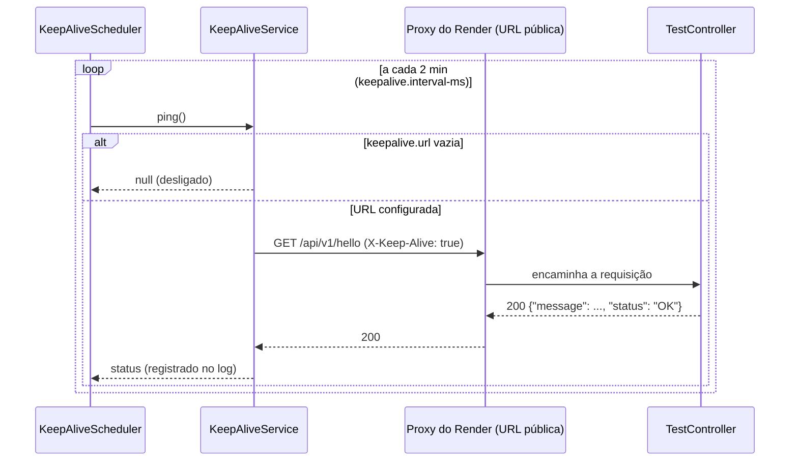

# Keep-alive do backend

O backend roda no Render e hiberna quando fica sem tráfego de entrada. O `KeepAliveScheduler` faz o servidor chamar a própria URL pública a cada 2 minutos. Como a chamada passa pelo proxy do Render, ela conta como tráfego e a instância não dorme, mesmo sem ninguém com o app aberto.

## Fluxo principal

1. O Spring dispara `KeepAliveScheduler.ping()` a cada `keepalive.interval-ms` (padrão 120000 ms), com o primeiro disparo após um intervalo.
2. O scheduler só delega para `KeepAliveService.ping()`.
3. Se `keepalive.url` está vazia, o service não faz nada. É o padrão em dev e nos testes.
4. Com a URL configurada, o service faz um `GET` com timeout de 10 s à URL pública, que atinge `GET /api/v1/hello`. Esse endpoint é público e não toca no banco.
5. O resultado vai para o log. Qualquer falha de rede vira um `warn` e o scheduler segue para o próximo ciclo.

## Configuração

No Render, defina `KEEP_ALIVE_URL=https://apptasks-e6oh.onrender.com/api/v1/hello`. `KEEP_ALIVE_INTERVAL_MS` é opcional.

## Limitação

Uma instância que já está dormindo não consegue se pingar. O workflow `.github/workflows/keep-alive.yml` continua servindo para acordá-la.
