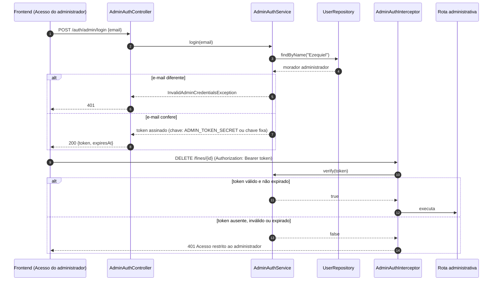

# Login do administrador apenas com e-mail

## O que muda

O login do administrador deixa de exigir a variável `ADMIN_TOKEN_SECRET`. O administrador entra informando somente o e-mail do morador `Ezequiel`, cadastrado na tabela `users`.

A variável continua opcional. Quando definida, é usada como chave de assinatura do token. Quando ausente, o backend usa uma chave fixa definida no código.

## Risco aceito

Com a chave fixa, quem souber o e-mail do administrador consegue acessar as rotas administrativas. O e-mail aparece no `seed.sql` do repositório. A proteção deixa de depender de segredo e passa a depender apenas do e-mail.

## Fluxo principal

## Passos principais

1. O frontend envia o e-mail digitado para `POST /auth/admin/login`.
2. `AdminAuthService` busca o morador `Ezequiel` e compara o e-mail, sem diferenciar maiúsculas e minúsculas.
3. Se o e-mail bater, o serviço emite um token assinado com HMAC-SHA256, válido por `ADMIN_TOKEN_TTL_HOURS` (168 horas por padrão).
4. Nas rotas protegidas, `AdminAuthInterceptor` valida o token do cabeçalho `Authorization`.
5. Sem o segredo configurado, a assinatura usa a chave fixa, e o restante do fluxo é idêntico.
