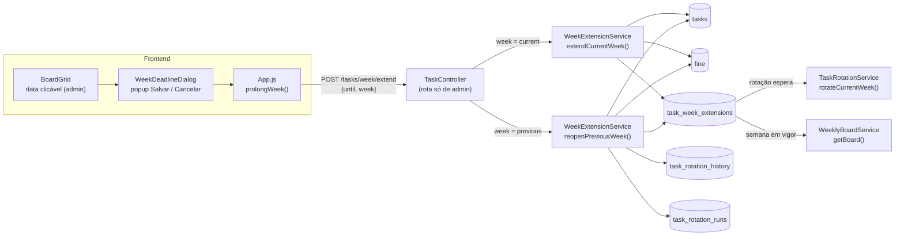

# Editar o prazo de uma semana

O administrador clica na data da semana em foco no carrossel e escolhe um novo prazo num popup, que pergunta se pode salvar. Vale para a semana atual (prorroga o prazo) e para a anterior (reabre a semana).

## Fluxo principal

1. O admin foca a semana atual ou a anterior no carrossel e clica na data dela. A semana seguinte não é editável.
2. O popup sugere o prazo atual (ou amanhã às 23:59, se ele já passou), avisa o que vai acontecer e só deixa salvar uma data futura.
3. Ao salvar, `POST /tasks/week/extend` envia o novo prazo e a semana (`current` ou `previous`). A rota exige o token de administrador.
4. **Semana atual:** todas as tarefas ganham o novo prazo, as multas automáticas da semana são canceladas e a prorrogação é registrada em `task_week_extensions`. A rotação espera até uma hora depois do novo prazo, para o job de multas avaliar o que for devido.
5. **Semana anterior:** ela volta a ser a atual e a atual passa a ser a próxima. As tarefas voltam a quem as tinha, com o estado de então. A rotação da semana atual é desfeita (`task_rotation_runs` e histórico posteriores), as multas aplicadas quando a semana anterior venceu são canceladas e o resultado dela é apagado para ser gravado de novo.
6. O quadro mostra a semana prorrogada como atual enquanto a rotação está adiada. Depois do prazo, a rotação roda e grava o resultado de verdade.

## Detalhes e limites

- As multas não guardam a tarefa de origem. O cancelamento usa uma janela de tempo: na semana atual, dois segundos em torno de `fine_applied_at`; na reabertura, do vencimento da semana até a rotação seguinte, só para moradores com multa registrada ou sem registro.
- Multas já pagas não são apagadas, e a tarefa continua marcada como multada para não ser multada de novo.
- Tarefas apagadas depois da semana reaberta não voltam. Tarefas criadas depois dela ficam como estão, só com o novo prazo.

## Migração

`V6__task_week_extensions.sql` cria `task_week_extensions`. O projeto não roda migrações sozinho: execute o SQL no Supabase **antes** do deploy do backend.
