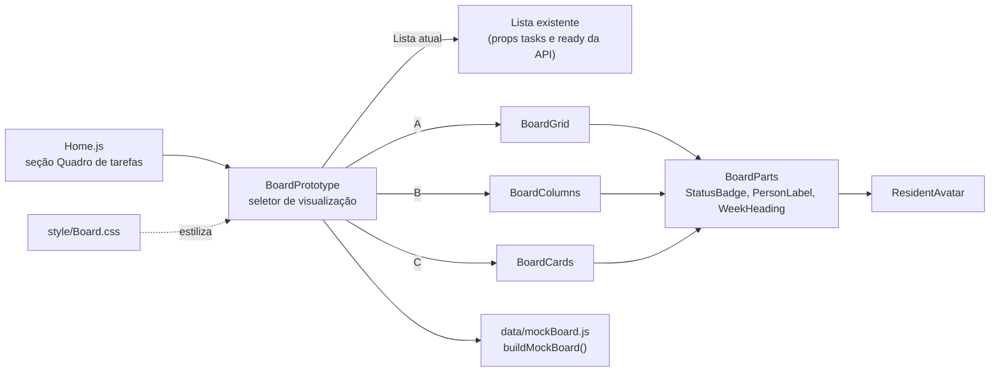

# Quadro semanal (protótipos)

Três protótipos do quadro de tarefas, organizados por semanas do mês e por morador, para decidir qual desenho seguir. Usam dados de exemplo no frontend: o backend ainda não guarda o resultado das semanas passadas.

## Fluxo principal

1. A `Home` renderiza o `BoardPrototype` e passa a lista de tarefas que já existia como `listView`.
2. O quadro abre em "Lista atual", então o comportamento em produção não muda até alguém escolher um protótipo.
3. Ao escolher A, B ou C, o `BoardPrototype` monta o quadro com `buildMockBoard()`: semanas de segunda a domingo que tocam o mês (mesma definição de semana do backend) e 4 moradores com resultados de exemplo.
4. Cada variante mostra a semana atual destacada, a tarefa de cada pessoa e o estado (Concluída, Não feita, Pendente, Em breve) pelo `StatusBadge`.
5. Um aviso informa que os dados são de exemplo.

## Limitação conhecida e próximo passo

O backend zera `is_completed` e `decision_at` a cada rotação semanal, e `task_rotation_history` guarda só quem recebeu a tarefa. Depois de escolher a variante, será preciso gravar o desfecho de cada semana no histórico e expor um endpoint mensal.
