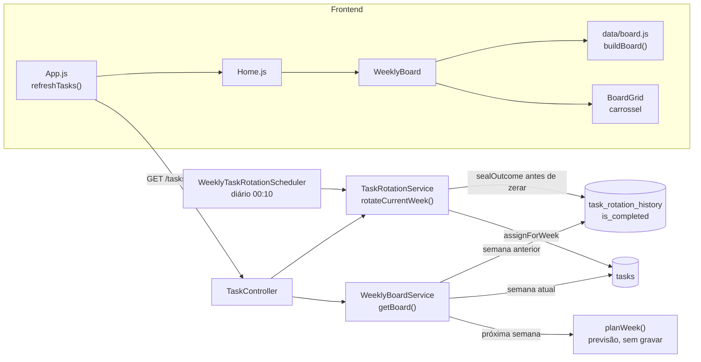

# Quadro semanal (carrossel)

O quadro de tarefas da Home é um carrossel com a semana anterior, a atual e a próxima. A semana atual fica em foco no centro; as vizinhas ficam desfocadas atrás e, ao clicar, vêm para o foco e mostram cada tarefa de cada morador com o resultado. Os dados vêm do backend.

## Fluxo principal

1. Ao abrir a Home, o `App` chama `GET /tasks/board` junto com as outras requisições. Enquanto não responde, o card mostra o esqueleto de carregamento.
2. O `TaskController` garante que a semana atual foi rotacionada e pede o quadro ao `WeeklyBoardService`.
3. O serviço monta três semanas: a anterior vem do histórico (`done`, `missed` ou `unknown` quando não há registro), a atual vem ao vivo de `tasks` (`done` ou `pending`) e a próxima é prevista por `planWeek()`, a mesma regra da rotação, sem gravar nada.
4. No frontend, `buildBoard()` cruza as entradas com os moradores. Um morador pode ter várias tarefas na mesma semana, ou nenhuma ("Sem tarefa").
5. Clicar numa semana desfocada, usar as setas ou os pontos traz essa semana para o foco.
6. Após uma decisão "Fiz" ou "Ainda não fiz", o `App` atualiza o quadro.

## Como o resultado das semanas é guardado

A rotação zera `is_completed` e `decision_at` em `tasks` a cada semana. Antes de zerar, `rotateCurrentWeek()` chama `sealOutcome()`, que grava o resultado na linha mais recente do `task_rotation_history` da tarefa, se ela ainda não tiver resultado. Só há esse ponto de escrita. Colunas nulas significam "sem registro", então semanas anteriores ao deploy aparecem como "Sem registro" e não como "Não feita".

## Migração

`V5__task_rotation_outcome.sql` adiciona `is_completed`, `decision_at` e `fine_applied` em `task_rotation_history`. O projeto não roda migrações sozinho: execute o SQL no Supabase **antes** do deploy do backend, senão a rotação e o quadro falham por falta das colunas.
