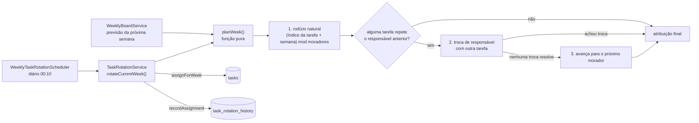

# Rotação semanal balanceada

A rotação semanal distribui as tarefas entre os moradores. Esta mudança corrige um caso em que um morador ficava com duas tarefas e outro com nenhuma.

## Fluxo principal

1. O rodízio natural põe a tarefa de índice `i` com o morador `(i + semana) mod n`. Com isso, as quantidades por morador diferem no máximo em uma tarefa.
2. As tarefas são ordenadas por `id` (UUID aleatório). Cadastrar ou remover uma tarefa muda os índices, e uma tarefa pode cair no mesmo morador da semana anterior.
3. Antes, essa tarefa simplesmente avançava para o próximo morador. Isso podia dar duas tarefas a um morador e nenhuma a outro.
4. Agora, ela troca de responsável com outra tarefa que não gere repetição para nenhuma das duas. A troca mantém a contagem por morador.
5. Só se nenhuma troca resolver, a tarefa avança para o próximo morador, como antes. Isso acontece, por exemplo, com uma única tarefa.
6. A mesma função `planWeek()` alimenta a rotação e a previsão da próxima semana no quadro, então as duas concordam.

## Efeito

Vale a partir da próxima rotação. A semana atual já foi atribuída e não muda sozinha: para corrigi-la, reatribua uma tarefa pelo painel administrativo.
