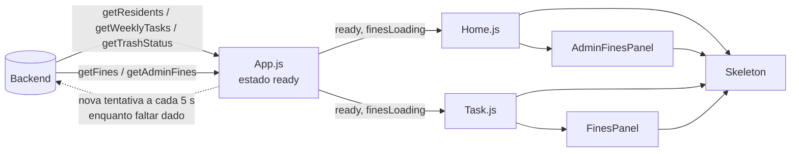

# Esqueleto de carregamento sem dados do backend

O frontend deixou de exibir dados inventados quando o backend não responde. Cada recurso (moradores, tarefas, lixo, multas) só é considerado pronto depois da primeira resposta bem-sucedida. Até lá, a tela mostra o componente `Skeleton`, uma animação de formas pulsando.

## Fluxo principal

1. O `App` guarda `ready = { tasks, residents, trash }`, todos falsos no início, mais um `ready` próprio para as multas.
2. `refreshTasks` busca moradores, tarefas e lixo com `Promise.allSettled`. Cada recurso só vira pronto quando a sua chamada tem sucesso, e nunca volta a falso por causa de uma falha posterior.
3. Enquanto algum recurso não estiver pronto, `Home` e `Task` renderizam `Skeleton` no lugar da lista, em vez da lista fixa de moradores ou de um estado vazio.
4. Enquanto faltar algum recurso, o `App` repete a busca a cada 5 s. Isso cobre o backend acordando do cold start.
5. Depois do primeiro sucesso, as atualizações seguem em segundo plano sem piscar o esqueleto. Se uma atualização falhar, a tela mantém os últimos dados e mostra o aviso de erro.
